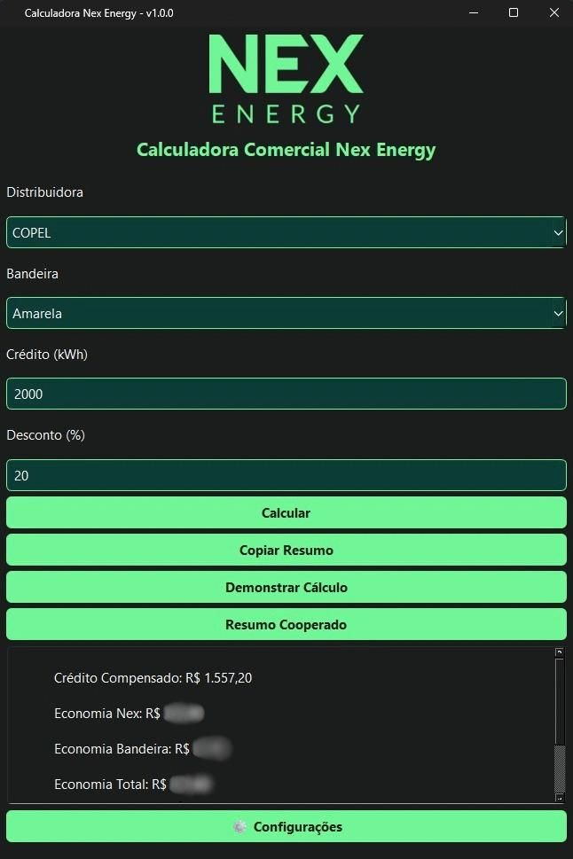

# Calculadora Comercial Nex

Aplicação desktop para organizar entradas e apresentar simulações comerciais relacionadas à compensação de créditos de energia.

**Tecnologias:** Python · PySide6 · PyInstaller

**Versão apresentada:** 1.0.0 · Windows

**Disponibilidade:** portfólio documental; código-fonte e executável privados.

## Problema e solução

O projeto reúne os dados de uma simulação em uma interface gráfica e apresenta um resumo dos resultados, com recursos para consultar demonstrativos e copiar resumos. O objetivo é apoiar a organização e a apresentação das simulações comerciais.

**Minha participação:** desenvolvimento da aplicação como projeto próprio em Python e PySide6. A autoria do projeto é minha; ferramentas de IA fazem parte do meu processo de desenvolvimento e revisão, sem substituir a responsabilidade pelas decisões e pelos resultados.

## Interface da aplicação

Captura já publicada neste repositório, preservada sem alterações. A imagem apresenta a interface; não disponibiliza as regras internas do aplicativo.

## Funcionalidades da versão apresentada

- Seleção de distribuidora e bandeira tarifária.
- Entrada do crédito de energia em kWh e do percentual de desconto.
- Exibição de um resumo dos resultados calculados.
- Abertura de demonstrativos do cálculo.
- Cópia de resumos para a área de transferência.
- Tela de configuração de parâmetros tarifários.

## Tecnologias e competências exercitadas

| Tecnologia | Aplicação no projeto |
| --- | --- |
| Python | Lógica da aplicação e organização dos fluxos |
| PySide6 | Interface desktop, campos, seleções e ações do usuário |
| PyInstaller | Empacotamento para execução no Windows |

O projeto exercita a transformação de uma necessidade prática em software, a organização de entradas e saídas e a integração entre interface e lógica de aplicação.

## Disponibilidade e limites

Este repositório apresenta documentação e a captura de interface já publicada. O código-fonte, o executável, as fórmulas, as tarifas, os parâmetros comerciais e as configurações internas permanecem privados. Não há download do aplicativo.

A documentação permite conhecer a proposta e a interface, mas não reproduzir nem auditar os cálculos. Não são divulgados resultados adicionais, dados de clientes ou novos materiais comerciais.

---

Portfólio pessoal. A apresentação não concede licença de uso do aplicativo privado, de suas regras comerciais ou de marcas associadas.
